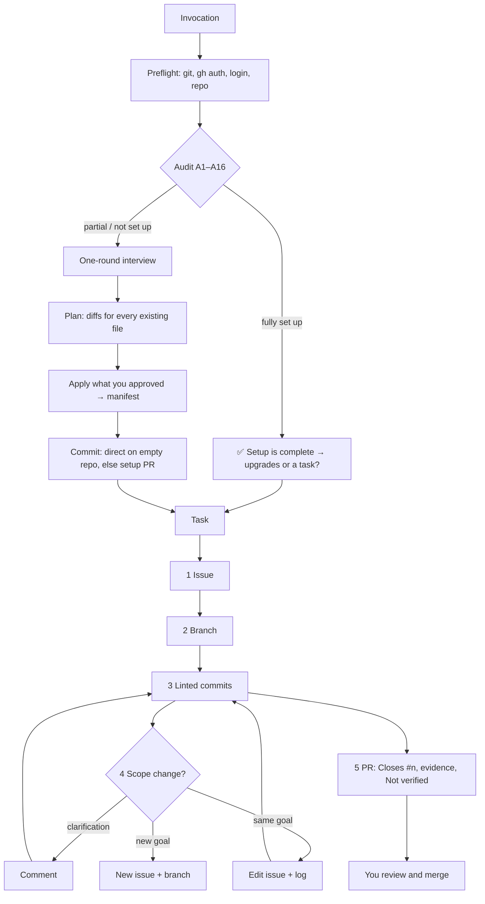

<div align="center">

# ⛵ cutwater

**An issue-first GitHub workflow for AI coding agents.**

Every change traced from issue to branch to commits to pull request, and you always merge.

[](https://github.com/YourAKShaw/CutWater/actions/workflows/test.yml)
[](skills/cutwater/SKILL.md)
[](skills/cutwater/scripts/README-scripts.md)
[](https://www.conventionalcommits.org/en/v1.0.0/)
[](LICENSE)

[Explore the skill](skills/cutwater/SKILL.md) · [Documentation](docs/README.md) · [Usage guide](docs/SKILL-USAGE.md) · [Contribute](.github/CONTRIBUTING.md) · [Get help](.github/SUPPORT.md) · [Security](SECURITY.md)

</div>

---

## Agents change code faster than anyone can trace it

Ask a coding agent to "fix the login bug" and you often get a pile of edits on whatever branch was checked out. There is no issue saying what was wrong, no criteria for done, and commit messages nobody will search. If you say "merge it", it might. Ask it to "also add dark mode" halfway through, and the bug fix and the feature end up in one unrevertable PR.

**cutwater** is an [Agent Skill](https://agentskills.io/specification) that gives the agent a professional, GitHub-native workflow, through the `gh` CLI and `git`:

> **Phase 0** audits the repository and sets up whatever is missing, with your approval. Then every task runs **issue → branch → Conventional Commits → pull request**. Scope changes are classified and recorded on the issue. **The agent never merges.**

The name: a ship's *cutwater* is the forward edge of the bow, the part that goes first. This skill always goes first with setup, then keeps every change on a clear line.

## ⚙️ What it brings to your agent

| Capability | What it means in practice |
| :--- | :--- |
| **Repository setup that is idempotent** | Audits 16 items (README, LICENSE, CONTRIBUTING, Contributor Covenant 3.0, SECURITY, issue forms, PR template, CODEOWNERS, CI, Dependabot, ignore files, labels, ruleset, manifest). A one-round interview, a plan you approve, and a second run that changes nothing. |
| **Never overwrites blindly** | Existing files get a unified diff and a per-file yes. A file edited after planning is refused (compare-and-set). |
| **Issue-first traceability** | Structured issue bodies, `<login>/<type>/<n>-<slug>` branches, linted Conventional Commits referencing `#n`, and PRs with `Closes #n`, testing evidence and a mandatory **Not verified** section. |
| **Interruption discipline** | "Also handle the empty state" → edit the issue and log it. "Add dark mode" → a new issue and branch. Each decision is stated in one line. |
| **Safety by construction** | Merging is forbidden; destructive actions are gated; GitHub text is treated as data; every call is pinned to one repository; outgoing bodies are secret-scanned. |
| **Deterministic helper** | A zero-dependency Node.js 18+ CLI does the fragile work, with `--json`, `--dry-run`, typed errors and stable exit codes. The agent runs it, never reads it. |
| **Portable** | Spec-only frontmatter works in Claude Code, Codex, Antigravity and other Agent Skills clients, with `agents/openai.yaml` for Codex. |

## 🧩 How it works



## 📥 Get started

The skill lives in [`skills/cutwater/`](skills/cutwater/SKILL.md). Keep that folder intact. You need `git`, an authenticated [`gh`](https://cli.github.com), and Node.js 18+.

### Claude Code: plugin

```text
/plugin marketplace add YourAKShaw/CutWater
/plugin install cutwater@cutwater
```

### Claude Code, Codex, Antigravity: copy the folder

```sh
git clone https://github.com/YourAKShaw/CutWater.git
cp -R CutWater/skills/cutwater ~/.claude/skills/        # Claude Code
cp -R CutWater/skills/cutwater ~/.agents/skills/        # Codex
cp -R CutWater/skills/cutwater ~/.gemini/antigravity/skills/   # Antigravity
```

Project-level paths, the Claude app ZIP upload, explicit-only invocation and troubleshooting are in the [usage guide](docs/SKILL-USAGE.md).

### Check it

```sh
node ~/.claude/skills/cutwater/scripts/cutwater.mjs preflight
```

## 💬 Put it to work

> /cutwater set up this repo

> Start a task to add rate limiting to the public API.

> Actually, make it OAuth instead of passwords.

> What's the status of my open PRs and branches?

> Update the wiki with an architecture page.

> Looks good, merge it for me. *(It will give you the command instead.)*

## 🧰 The helper

```sh
cw=~/.claude/skills/cutwater/scripts/cutwater.mjs
node $cw audit                                   # A1–A16 and a classification, read-only
node $cw defaults --out /tmp/answers.json        # interview defaults
node $cw plan --answers /tmp/answers.json --out /tmp/plan.json
node $cw apply --plan /tmp/plan.json --yes file:README.md   # gated ids need your yes
node $cw branch-name --type feat --issue 42 --title "Add token refresh"
node $cw lint-commit "feat(auth): :sparkles: add token refresh (#42)" --issue 42
node $cw status
```

Exit codes: `0` ok · `1` usage or validation · `2` needs confirmation · `3` auth or scope · `4` conflict · `5` remote error.

## 📚 Inside the skill

| Material | Contents |
| :--- | :--- |
| [SKILL.md](skills/cutwater/SKILL.md) | Hard rules, helper usage, preflight, Phase 0, the task loop, interruptions, gates, output style |
| [Audit checklist](skills/cutwater/references/init-checklist.md) | A1–A16, classification, org defaults, what setup creates, scaffold order |
| [Interview](skills/cutwater/references/interview.md) | Questions, defaults, stack detection, the one-round template |
| [Task lifecycle](skills/cutwater/references/task-lifecycle.md) | Issue bodies, branches, commits, PR bodies, trivial edits, resuming |
| [Interruptions](skills/cutwater/references/interruptions.md) | The comment, edit-and-log and new-issue rules, with worked examples |
| [gh commands](skills/cutwater/references/gh-commands.md) | The command table per phase, token scopes, manual mode |
| [Wiki](skills/cutwater/references/wiki.md), [extensions](skills/cutwater/references/extensions.md) | The wiki first-page hand-off; status, CI triage, cleanup, releases, Projects |
| [Security](skills/cutwater/references/security.md) | Threat model, injection defences, gates, least privilege, client deny rules |
| [Assets](skills/cutwater/assets/) | Community templates, issue forms and skeletons, CI, Dependabot, labels, ruleset, manifest schema |

## 📂 Inside the repository

```text
CutWater/
├── skills/cutwater/      # The Agent Skill (what gets installed)
├── src/                  # TypeScript source of the helper (bundled into skills/cutwater/scripts/)
├── test/                 # Unit tests, a fake GitHub, integration tests through the bundle
├── sandbox/              # Repository-state fixtures and a real-GitHub reset script
├── evals/                # Scenario and triggering evals with scoring gates
├── scripts/              # Build, package validator, eval tooling
├── docs/                 # Usage, architecture, ADRs, evaluation, maintenance, roadmap
├── .claude-plugin/       # Claude Code plugin and marketplace manifests
└── .github/              # CI, release, issue forms, PR template, contributing, support
```

## ✅ Validate

With Node.js 22.18+:

```sh
npm ci
npm run check
```

This runs the package validator, the bundle freshness check, the eval suite check, 95 unit and integration tests (including the idempotency gate on every sandbox fixture), and lint. These checks show that the package is well-formed and the helper behaves as tested. Whether agents follow the skill is measured by the [evals](evals/README.md), and **no eval results have been recorded yet**.

---

## 🤝 Contributing and support

Real transcripts where an agent broke a rule are the most valuable contribution, followed by new stacks, helper fixes and eval runs. Start with the [contribution guide](.github/CONTRIBUTING.md), use the [issue forms](https://github.com/YourAKShaw/CutWater/issues/new/choose), or read the [support guide](.github/SUPPORT.md). Report vulnerabilities privately, as described in the [security policy](SECURITY.md). Everyone follows the [Code of Conduct](CODE_OF_CONDUCT.md).

## License

Distributed under the **MIT License**. See [LICENSE](LICENSE).
