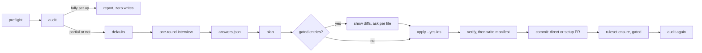

# Architecture

## Contents

- [Repository layout](#repository-layout)
- [Progressive disclosure](#progressive-disclosure)
- [The helper](#the-helper)
- [Setup data flow](#setup-data-flow)
- [Idempotency](#idempotency)
- [Safety layers](#safety-layers)
- [Decisions](#decisions)

## Repository layout

```text
CutWater/
├── skills/cutwater/              # The shipped Agent Skill (what users install)
│   ├── SKILL.md                  # Router: hard rules, phase flow, helper usage (≤ 300 lines)
│   ├── LICENSE                   # MIT, travels with the skill
│   ├── agents/openai.yaml        # Codex UI metadata and invocation policy
│   ├── references/               # Loaded on demand, each linked from SKILL.md, never from each other
│   ├── assets/                   # Templates, labels, ruleset, manifest schema, client deny rules
│   └── scripts/cutwater.mjs      # Bundled zero-dependency helper (generated)
├── src/                          # TypeScript source of the helper
├── test/                         # node:test unit tests, fake GitHub, integration tests
├── sandbox/                      # Repository-state fixtures and the real-GitHub reset script
├── evals/                        # Scenario and triggering evals, baseline protocol
├── scripts/                      # build, package validator, eval tooling
├── docs/                         # This documentation and the ADRs
├── .claude-plugin/               # Claude Code plugin and marketplace manifests
└── .github/                      # CI, release, issue forms, PR template, contributing, support
```

## Progressive disclosure

| Tier | Loaded | Contents | Budget |
| :--- | :--- | :--- | :--- |
| 1 | Always, at startup | `name` and `description` | ≤ 1,024 characters (553 today) |
| 2 | When the skill activates | `SKILL.md` body | ≤ 300 lines and ~5,000 tokens (145 lines, ~2,500 tokens today) |
| 3 | When a phase needs it | One reference file | Files over 100 lines start with a Contents section |
| — | Never read | `scripts/cutwater.mjs` | Executed; only its output enters the context |

References never link to each other, because agents sometimes preview files partially and nested links lead to incomplete reads. The package validator enforces every one of these limits.

## The helper

`src/` is bundled by esbuild into `skills/cutwater/scripts/cutwater.mjs`: one ESM file for Node.js 18+, with no dependencies.

| Module | Responsibility |
| :--- | :--- |
| `lib/exec.ts` | The only place processes start: argument arrays and no shell, the allowlist, repository pinning, dry-run, retries, call logging |
| `lib/errors.ts` | Typed errors (`AUTH`, `SCOPE`, `NOT_FOUND`, `RATE_LIMIT`, `CONFLICT`, `VALIDATION`, …), remediation lines, exit codes |
| `lib/preflight.ts` | git state, gh auth and scopes, login discovery, repository resolution |
| `lib/audit.ts` | Items A1–A16, org defaults, classification |
| `lib/answers.ts`, `lib/detect.ts` | Interview defaults, validation, stack profiles, template variables |
| `lib/templates.ts` | The strict template renderer and asset lookup |
| `lib/plan.ts` | Render and compare every file: create, skip, update or conflict, with diffs |
| `lib/apply.ts` | Gated application, compare-and-set, label sync, verification, manifest last |
| `lib/manifest.ts` | Manifest schema validation and building |
| `lib/labels.ts`, `lib/ruleset.ts` | Label diffing and upserts; ruleset lookup, comparison, POST or PUT |
| `lib/commitlint.ts`, `lib/branch.ts` | Conventional Commit linting; branch names |
| `lib/body.ts`, `lib/secrets.ts` | Issue and PR bodies; the secret scanner |
| `lib/read.ts` | The only reader of GitHub text: author-trust gating, invisible-character stripping, injection signals, fencing, CI-log tails |
| `lib/github.ts` | Reactions, status, wiki check |
| `cli.ts` | Subcommands, `--json` and human output, exit codes |

Exit codes: 0 ok, 1 usage or validation, 2 needs confirmation, 3 auth or scope, 4 conflict, 5 remote error.

## Setup data flow



## Idempotency

- `plan` compares the EOL-normalised SHA-256 of each rendered file with the file on disk. Identical files are `skip`, so a second run on a set-up repository has no create, update or conflict entries.
- Labels are diffed by name, color and description, and only differences are upserted with `--force`.
- The manifest's `updatedAt` changes only when its content changes, so a no-op run leaves it byte-identical.
- The ruleset is looked up by name or by its `~DEFAULT_BRANCH` target, and compared semantically before any POST or PUT.
- `apply` re-checks each file's hash immediately before writing it (compare-and-set) and aborts that entry if the file changed after planning.

The integration tests run setup twice through the real bundle and assert zero API mutations and a byte-identical manifest on the second run.

## Safety layers

1. **Instructions** in `SKILL.md` and `references/security.md`: the hard rules, gates, and GitHub text treated as data.
2. **Helper enforcement:** the allowlist (no merge, no push, no shell, no raw issue or PR reads), `cw read` (non-collaborator text withheld by default, injection signals, fenced output), repository pinning, gated `apply` and `ruleset ensure`, compare-and-set, and secret-scanned bodies.
3. **Optional client rules:** Claude Code deny rules and Codex prefix rules in `assets/client-rules/`.
4. **Scaffolded hygiene:** read-only workflow permissions, SHA-pinned actions, no `pull_request_target`, and Dependabot for actions.

## Decisions

The [ADRs](adr/README.md) record the choices and their trade-offs.
